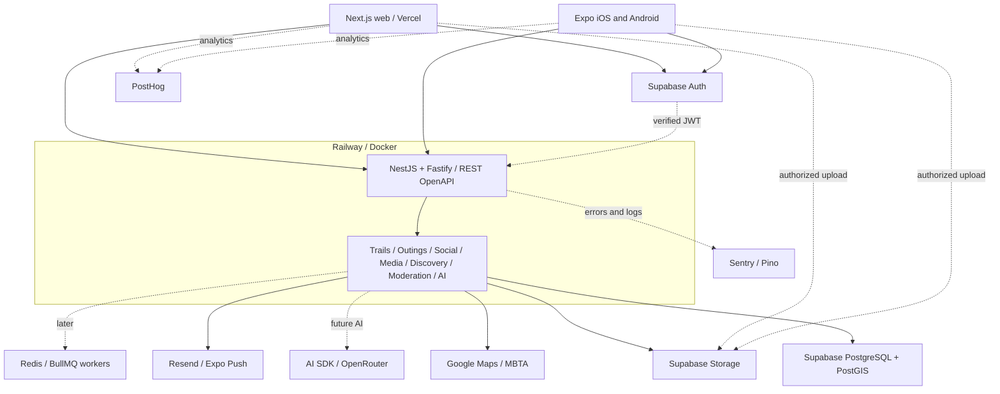
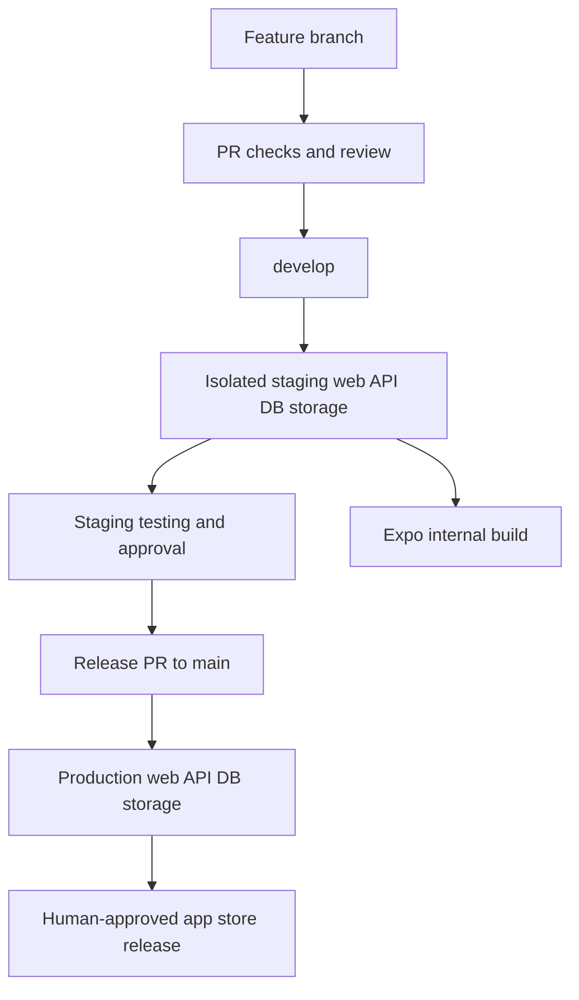

# Architecture

Status: target proposal; verify actual implementation against checklist.

## Current baseline
Vite/React browser → Supabase JS / RPC → PostgreSQL with RLS; Supabase Auth and Storage; Google Maps/MBTA; Vercel-hosted web and OG function. Check actual deployment settings before changes.

M00 inventory and verification limits: [BASELINE.md](BASELINE.md). No API service, mobile client, workspace or Next.js app exists yet. Existing Storage media is public; target private uploads require new design/tests.

## Target

Cloudflare DNS and applicable edge protection. Existing user-scoped SQL/RPC paths remain until authorization equivalence is verified. Drizzle is a proposed restricted query layer; Supabase CLI owns migrations. Avoid bypassing RLS. Published trails, individual/group outings and original crew are distinct concepts; design new schema additively.

## Deployment

Use isolated credentials/data, approved migration order and immutable backend image promotion where feasible. Mobile clients require compatible API versions. Staging URL proposed: staging.breadcrumb.boston; not verified live.

## Repository target
```
apps/web/       # Vite initially, Next.js when ready
apps/api/       # NestJS, Dockerfile
apps/mobile/    # Expo
packages/       # database, types, validation, api-client, config, utils as needed
supabase/       # existing migrations, tests, seed and config
.github/        # CI/CD
infrastructure/ # compose and deployment notes as needed
docs/
```
